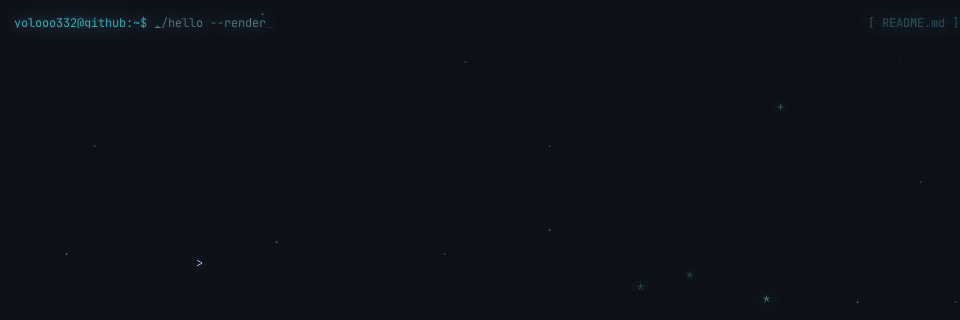
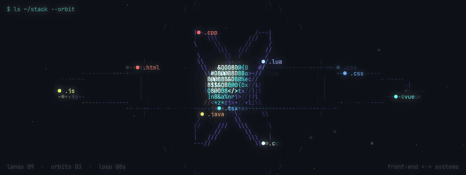

**Machine learning systems**, **self-hosted infrastructure** and **security**, on Linux. 
Student at Politehnica București, <i>Automatică și Calculatoare</i> · Bucharest, Romania

<table>
<tr>
<td width="50%" valign="top">

<b>ML systems</b> 
<i>from an LLM training project, launching soon</i>

- **Pipeline-parallel fine-tuning**: one model split by layers across GPUs in different machines, with 1F1B scheduling so the cards overlap instead of taking turns
- **QLoRA with PEFT + bitsandbytes 4-bit**, and per-GPU precision (bf16, fp16, fp32) with one dynamic loss scale for the whole chain
- **A memory-first planner** that estimates VRAM per stage and picks the split where the slowest GPU is fastest, using each card's measured speed
- **Streaming layers from pinned RAM**: a 32B model fine-tuned on a single 12 GB RTX 5070
- **0.92× Unsloth's per-GPU speed** on a 7B, with 16-bit autocast and per-layer `torch.compile`
- **A custom framed TCP protocol** for activations and gradients, plus tests showing split training gives the same losses and LoRA weights as the unsplit model

</td>
<td width="50%" valign="top">

<b>Infra & AI agents</b> 
<i>from my self-hosted home cluster, launching soon</i>

- **A cluster for people and coding agents**: a Bun + TypeScript server on Postgres that schedules jobs onto GPU and CPU workers across my machines
- **Scheduling with GPU-memory requests**, labels and taints, hyperparameter grid sweeps, multi-step pipelines and cron
- **Sandboxed runs** in Docker or Podman, with workers running as self-updating systemd user units
- **Agent orchestration**: Claude Code and Codex agents take tasks from a board, push their work, get an AI review, and auto-fix failed checks and merge conflicts
- **An MCP server and a knowledge base** so agents can search past runs and notes
- **CI before main**: lint, typing and tests run in a sandbox, merges are gated on review, and the repo is mirrored from Gitea to GitHub

</td>
</tr>
<tr>
<td width="50%" valign="top">

<b>Security</b>

- Encrypted secrets, injected into each run and hidden from its logs
- Invite-based enrollment for workers and people, behind Cloudflare Access
- Encrypted backups of the cluster's state
- Threat modelling of the apps I build

</td>
<td width="50%" valign="top">

<b>Linux</b>

- Fedora as my daily driver, with Linux servers and workers running the home cluster
- Operating system modifications and new desktop features, coming to this profile soon

</td>
</tr>
</table>

  
  
  
  
  
  
   
  
  
  
  
  
  
  
  
  
   
  
  
  
  
  
  
  
  

The animations are drawn with letters, numbers and symbols by a small Python renderer in <a href="art/">art/</a>, a technique inspired by the ASCII code art of JIN2 (<a href="https://instagram.com/jin_22ee">@jin_22ee</a>).
