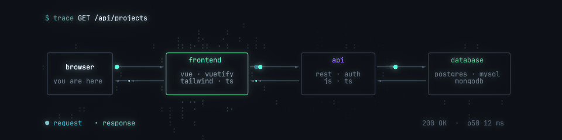
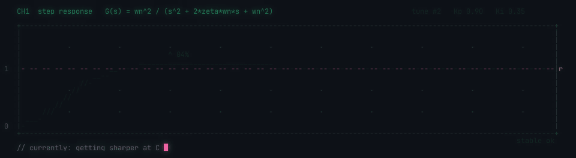

<div align="center">


</div>

```text
CALIN(1)                     Yolooo332 User Manual                     CALIN(1)

NAME
       calin - full-stack web developer, student at Politehnica Bucuresti

SYNOPSIS
       calin [--front vue|tsx|html] [--back js|ts] [--db sql|mongo]
             [--low-level c|cpp|lua|java] [--city bucharest]
```

<p align="center"></p>

<div align="center">

**Full-stack web developer**, from the `.vue` component in the browser down to the row in the database.<br>
Student at **Politehnica București**, *Automatică și Calculatoare*.

<table>
  <tr>
    <td align="center" width="260"><sub><i>based in</i></sub><br><b>Bucharest, Romania</b></td>
    <td align="center" width="260"><sub><i>writes mostly</i></sub><br><code>.vue</code> <code>.tsx</code> <code>.html</code> <code>.js</code><br><code>.cpp</code> <code>.lua</code> <code>.java</code></td>
    <td align="center" width="260"><sub><i>currently</i></sub><br><b>getting sharper at C</b></td>
  </tr>
</table>

</div>

<p align="center"></p>

<div align="center">

</div>

<p align="center">
  
  
  
  
  
  
  
  
  
  <br>
  
  
  
  
  
  
  
  
</p>

<p align="center"></p>

<div align="center">

</div>

<p align="center"></p>

<pre>
<b>~/yolooo332</b>
├── <a href="https://github.com/Yolooo332/cpp">cpp/</a>                  C++
├── <a href="https://github.com/Yolooo332/anomaly-detection">anomaly-detection/</a>    kernel regression &amp; anomaly detection · MATLAB · fork
├── <a href="https://github.com/Yolooo332/Tema3">Tema3/</a>                PCLP1 · C
├── <a href="https://github.com/Yolooo332/SDA-Tema1">SDA-Tema1/</a>            data structures &amp; algorithms · C
└── <a href="https://github.com/Yolooo332/SDA-Midterm">SDA-Midterm/</a>          data structures &amp; algorithms midterm · C
</pre>

<p align="center"></p>

<div align="center">

</div>

Known issue: still tuning the C. The first pass rings and the second one settles. Work in progress.

<p align="center"></p>

```text
location     bucharest, romania
instagram    @f3.calin
school       politehnica bucuresti · automatica si calculatoare
```

<sub>Every frame on this page is drawn with letters, numbers and symbols by a small Python field renderer in <a href="art/">art/</a>. The technique is inspired by the ASCII code art of JIN2 (<a href="https://instagram.com/jin_22ee">@jin_22ee</a>).</sub>

```text
Yolooo332                        2026-11-12                            CALIN(1)
```
